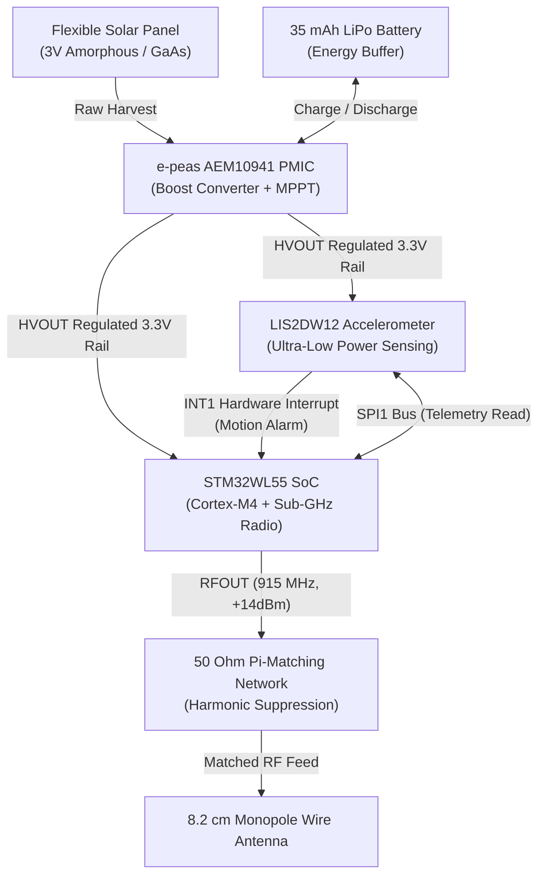

# Solar Telemetry: Sub-8g Avian Wildlife Telemetry Node

An ultra-lightweight ($<8.0\text{g}$), perpetually energy-autonomous telemetry beacon engineered for avian wildlife conservation and asset tracking. Colloquially conceived as a "Solar AirTag", the system is architected from the ground up to replace heavy, battery-limited commercial tags with a sub-GHz RF beacon powered by solar energy harvesting.

---

## 1. Architectural Motivation

### 1.1 Avian Wildlife Conservation & The 5% Mass Rule
In wildlife telemetry and ornithological research, animal welfare dictates strict physical constraints:
* **The 5% Body-Mass Rule:** International ethical guidelines require that any tracking apparatus must not exceed **$3\text{--}5\%$** of the bird's total body mass. Exceeding this limit impairs flight biomechanics, elevates metabolic expenditure, disrupts hunting, and skews behavioral data.
* **The Target Demographic:** Small-to-medium raptors—such as the American Kestrel (*Falco sparverius*, adult mass $100\text{g}\text{--}140\text{g}$), small falcons, and migratory shorebirds—have historically been excluded from continuous tracking due to the sheer bulk of existing hardware.
* **Limitations of Existing Commercial Tags:** Commercial avian trackers typically weigh $>15\text{g}\text{--}30\text{g}$, cost upwards of \$1,500, and rely on non-rechargeable primary lithium cells that die within months, requiring recapture or terminating studies prematurely.

This project addresses this conservation bottleneck by engineering a complete telemetry solution under **$8.0\text{g}$ total mass** (with a bare-board electronic budget of $<3.0\text{g}$) capable of indefinite operation via ambient solar energy.

### 1.2 Electrical Engineering Scope & Design Objectives
This repository encapsulates a complete hardware development lifecycle:
* **KiCad EDA Workflow:** Schematic capture, hierarchical netlist design, custom symbol/footprint creation with 3D STEP modeling, and 4-layer PCB layout.
* **Controlled-Impedance RF Routing:** $50\Omega$ coplanar waveguide design and $\Pi$-matching network synthesis for Sub-GHz ISM frequencies (915 MHz / 868 MHz).
* **Ultra-Low-Power (ULP) Power Architecture:** Integration of maximum power point tracking (MPPT) solar harvesting with sub-microamp quiescent sleep states.
* **Event-Driven Firmware Architecture:** Hardware-level asynchronous interrupt handling to decouple sensing from compute and transmission.

---

## 2. Engineering Criteria & Constraints

| Parameter | Target Constraint | Design Implementation |
| :--- | :--- | :--- |
| **Total System Mass** | $m \le 8.0\text{g}$ (Target: $6.4\text{g}$) | Lightweight 4-layer $0.8\text{mm}$ PCB, miniature passives, SLA resin enclosure. |
| **Power Autonomy** | Net-Positive Diurnal Balance ($\Delta E_{\text{day}} > 0$) | e-peas AEM10941 PMIC + flexible solar cell + 35 mAh LiPo buffer. |
| **Deep-Sleep Current** | $I_{\text{sleep}} \le 2.5\,\mu\text{A}$ at $3.3\text{V}$ | STM32WL55 in Stop2 mode ($1.2\,\mu\text{A}$) + LIS2DW12 low-power sensing ($0.38\,\mu\text{A}$). |
| **RF Carrier Frequency** | $915\,\text{MHz}$ (US) / $868\,\text{MHz}$ (EU) | Sub-GHz ISM band for extended line-of-sight propagation ($>5\text{--}15\,\text{km}$). |
| **RF Trace Impedance** | $Z_0 = 50.0\,\Omega \pm 5\%$ | JLC7628 stackup microstrip trace geometry with continuous L2 ground plane. |
| **Board Footprint** | $20.0\,\text{mm} \times 25.0\,\text{mm}$ | High-density component placement (0402 passives, UFQFPN-48, QFN-28). |

### Strict Mass Budget Breakdown ($6.4\text{g}$ Target)

| Subsystem | Component Details | Allocated Mass |
| :--- | :--- | :--- |
| **Bare PCB** | 4-Layer FR4 ($0.8\text{mm}$ core, $20\text{mm} \times 25\text{mm}$) | $0.8\text{g}$ |
| **Core Electronics** | STM32WL55 SoC, LIS2DW12 IMU, 0402/0603 passives | $0.6\text{g}$ |
| **Energy Harvester** | e-peas AEM10941 PMIC + 3V flexible solar cell | $0.7\text{g}$ |
| **Energy Buffer** | $3.7\text{V}$ 35 mAh ultra-light LiPo pouch cell | $1.8\text{g}$ |
| **RF Antenna System** | $50\Omega$ $\Pi$-network + $8.2\text{cm}$ micro-wire monopole | $0.3\text{g}$ |
| **Protective Housing** | SLA 3D-printed light-cured resin ($0.8\text{mm}$ wall) | $2.2\text{g}$ |
| **TOTAL** | **Fully Assembled Telemetry Node** | **$6.4\text{g}$** |

---

## 3. Engineering Trade-offs & Architecture



### Trade-off 1: Ground-Based TDoA Triangulation vs. Onboard GNSS
* **The Problem:** Commercial GPS modules require $15\text{--}30\,\text{mA}$ continuous current with cold-start Time-To-First-Fix (TTFF) durations between $15\text{--}45$ seconds. Each location fix consumes $2.0\text{--}4.0\,\text{Joules}$, demanding a battery exceeding $>10\text{g}$ and heavy ceramic patch antennas ($>2\text{g}$).
* **The Solution:** Offload localization to ground-based receiver arrays using **Time Difference of Arrival (TDoA)** multilateration. The tag acts purely as an RF beacon transmitting ultrashort $50\,\text{ms}$ sub-GHz bursts.
* **Energy Impact:** Reduces energy-per-transmission to $\approx 0.0033\,\text{J}$—a **$>600\times$ efficiency improvement** over GPS, eliminating onboard GPS hardware mass entirely.

### Trade-off 2: Integrated SoC (STM32WL55) vs. Discrete MCU + Transceiver
* **The Problem:** Separate MCU and RF transceiver chips require inter-chip SPI routing, redundant decoupling networks, duplicate crystals, and enlarged PCB real estate ($>300\,\text{mm}^2$), increasing board mass and parasitic trace losses.
* **The Solution:** Selected the **STM32WL55JC**, integrating an ARM Cortex-M4/M0+ controller and a Semtech SX126x-derived Sub-GHz radio onto a single $5\text{mm} \times 5\text{mm}$ UFQFPN-48 die.
* **Benefit:** Shrinks RF front-end footprint by $>40\%$, minimizes trace parasitic inductance, and eliminates MCU-to-radio bus latency.

### Trade-off 3: Solar MPPT PMIC (e-peas AEM10941) vs. Linear Charging
* **The Problem:** Lightweight flexible solar panels produce volatile open-circuit voltages ($0.5\text{V}\text{--}3.5\text{V}$) and micro-currents under varied daylight and canopy shade, making standard linear battery chargers unusable.
* **The Solution:** The **e-peas AEM10941** features an ultra-low-power boost converter with an integrated Maximum Power Point Tracking (MPPT) state machine that operates down to $100\,\text{mV}$ input and cold-starts at $380\,\text{mV}$. It provides dual regulated LDO outputs and overcharge/overdischarge protection for the 35 mAh buffer.

### Trade-off 4: Asynchronous Motion Wakeup (IMU EXTI) vs. Polling
* **The Problem:** Constantly waking the MCU to check sensors via timer polling would drain tens of microamps, depleting the miniature battery overnight.
* **The Solution:** The **ST LIS2DW12** 3-axis accelerometer runs independently in low-power mode ($<0.4\,\mu\text{A}$ at $1.6\,\text{Hz}$ ODR) monitoring acceleration thresholds. When movement occurs, its physical interrupt pin (`INT1`) asserts an asynchronous external interrupt (`PA0` / EXTI0) to pull the STM32WL55 out of deep sleep (Stop2 mode). The MCU transmits a telemetry burst, updates its counters, and immediately enters Stop2 sleep.

---

## 4. Technical Specifications & Governing Equations

### 4.1 RF Transmission Line & $50\Omega$ Microstrip Math
To ensure maximum power transfer and prevent reflective signal attenuation at $915\,\text{MHz}$, the RF trace from `RFOUT_HP` through the $\Pi$-matching network to the antenna pad is calculated as a microstrip transmission line referencing an unbroken Layer 2 ground plane.

```
       Trace Width (W)
          |=======|      --- Copper Thickness (T = 0.035 mm)
=============================
  Dielectric Prepreg (H = 0.1064 mm, Er = 4.05)
-----------------------------
============================= Solid Ground Plane (L2)
```

Using the **IPC-2141 / Wheeler microstrip equations** with copper thickness correction:

$$W_{\text{eff}} = W + \frac{T}{\pi} \left( 1 + \ln\left( \frac{2H}{T} \right) \right)$$

$$u = \frac{W_{\text{eff}}}{H}$$

$$\epsilon_{\text{eff}} = \frac{\epsilon_r + 1}{2} + \frac{\epsilon_r - 1}{2} \cdot \frac{1}{\sqrt{1 + 12/u}}$$

For $u > 1$:
$$Z_0 = \frac{120\pi}{\sqrt{\epsilon_{\text{eff}}} \left[ u + 1.393 + 0.667 \ln(u + 1.444) \right]}$$

* **Stackup Parameters:** JLCPCB JLC7628 4-Layer ($0.8\,\text{mm}$ thickness), $H = 0.1064\,\text{mm}$, $T = 0.035\,\text{mm}$ ($1\,\text{oz}$ copper), $\epsilon_r = 4.05$.
* **Synthesized Trace Width:** $W = 0.18\,\text{mm}$ ($7.1\,\text{mils}$) yields **$Z_0 = 50.0\,\Omega$**.
* **Antenna Design:** Quarter-wavelength ($\lambda/4$) wire monopole:
  $$L_{\text{ant}} = \frac{c}{4f} = \frac{3 \times 10^8\,\text{m/s}}{4 \times 915 \times 10^6\,\text{Hz}} \approx 82.0\,\text{mm} \; (8.2\,\text{cm})$$

### 4.2 Diurnal Energy Balance & Power Autonomy
Perpetual operation requires that total harvested energy exceeds total system dissipation over 24 hours:

$$\Delta E_{\text{day}} = E_{\text{harvest}} - E_{\text{consumed}} > 0$$

#### Consumption Budget (24-Hour Cycle)
* **Sleep Mode ($23.999\,\text{hours/day}$):**
  $$Q_{\text{sleep}} = I_{\text{sleep}} \cdot 24\,\text{h} = 2.5\,\mu\text{A} \times 24\,\text{h} = 60.0\,\mu\text{Ah}$$
* **Active RF Bursts ($50\text{ bursts/day}$ at $20\,\text{mA}$, $50\,\text{ms}$ duration):**
  $$Q_{\text{tx, burst}} = I_{\text{tx}} \cdot t_{\text{tx}} = 20\,\text{mA} \times \left(\frac{0.05\,\text{s}}{3600\,\text{s/h}}\right) \approx 0.278\,\mu\text{Ah}$$
  $$Q_{\text{tx, daily}} = 50 \times 0.278\,\mu\text{Ah} \approx 13.9\,\mu\text{Ah}$$
* **Total Daily Drain:**
  $$Q_{\text{total, consumed}} = 60.0\,\mu\text{Ah} + 13.9\,\mu\text{Ah} = \mathbf{73.9\,\mu\text{Ah/day}} \; (0.074\,\text{mAh/day})$$

#### Solar Harvesting Model
Using a miniature flexible solar panel producing peak current $I_{\text{sc}} = 350\,\mu\text{A}$ across a 6-hour diurnal sunlight window with sinusoidal insolation:
$$t_{\text{effective}} = \frac{2}{\pi} \cdot t_{\text{sun}} = \frac{2}{\pi} \times 6.0\,\text{h} \approx 3.82\,\text{h}$$
$$Q_{\text{harvest, raw}} = 350\,\mu\text{A} \times 3.82\,\text{h} \approx 1337\,\mu\text{Ah}$$
Accounting for PMIC boost conversion efficiency ($\eta_{\text{PMIC}} \approx 85\%$):
$$Q_{\text{harvest, stored}} = 1337\,\mu\text{Ah} \times 0.85 = \mathbf{1136\,\mu\text{Ah/day}} \; (1.14\,\text{mAh/day})$$

#### Net Margin & Zero-Sun Endurance
$$\Delta Q_{\text{net}} = 1136\,\mu\text{Ah} - 73.9\,\mu\text{Ah} = \mathbf{+1062.1\,\mu\text{Ah/day}} \; (\text{Net Positive})$$

With a 35 mAh LiPo buffer operating within an $80\%$ depth of discharge window ($28\,\text{mAh}$ usable):
$$\text{Zero-Sunlight Autonomy} = \frac{28.0\,\text{mAh}}{0.074\,\text{mAh/day}} \approx \mathbf{378\,\text{days of operation without sun}}$$

### 4.3 12-Byte Packed Telemetry Packet Architecture
To keep RF burst transmission duration strictly under $50\,\text{ms}$, telemetry data is structured as an aligned 12-byte binary payload:

```
 0        1        2        3        4        5        6        7        8        9       10       11
+--------+--------+--------+--------+--------+--------+--------+--------+--------+--------+--------+--------+
|   Device ID     |   Battery mV    |            Motion Count         |  Accel Z (mg)  | Reason | Status |
|    (uint16)     |    (uint16)     |              (uint32)           |    (int16)     | (uint8)| (uint8)|
+--------+--------+--------+--------+--------+--------+--------+--------+--------+--------+--------+--------+
```

---

## 5. Hardware Implementation & KiCad Project

All hardware files are developed in KiCad 8 and located in [`solar-airtag-kicad/`](./solar-airtag-kicad):

* **Schematic:** [`solar-airtag-kicad.kicad_sch`](./solar-airtag-kicad/solar-airtag-kicad.kicad_sch) — Full schematic with subcircuits for the AEM10941 PMIC, STM32WL55 SoC, LIS2DW12 IMU, 32MHz TCXO, and RF $\Pi$-matching filter.
* **PCB Layout:** [`solar-airtag-kicad.kicad_pcb`](./solar-airtag-kicad/solar-airtag-kicad.kicad_pcb) — 4-layer $20\text{mm} \times 25\text{mm}$ board layout with uninterrupted L2 GND reference plane.
* **Component Libraries:** [`libraries/`](./solar-airtag-kicad/libraries) — Custom verified schematic symbols, IPC-compliant footprints, and 3D STEP models for the AEM10941-QFN and LIS2DW12TR LGA-12.

---

## 6. Future Steps & Development Roadmap

1. **PCB Optimization & DRC Verification**
   - Refine RF coplanar waveguide routing and via fence ground stitching around the $915\,\text{MHz}$ trace.
   - Run complete Design Rule Checks (DRC) and Electrical Rule Checks (ERC) against JLCPCB 4-layer manufacturing constraints.
   - Panelize and export Gerber, drill, and centroid files for SMT assembly.

2. **Firmware & Software Development**
   - Initialize STM32WL55 bare-metal / RTOS project using STM32CubeIDE.
   - Implement low-power driver for LIS2DW12 (SPI communication, interrupt threshold configuration, and deep-sleep management).
   - Configure Sub-GHz radio HAL for FSK / LoRa packet transmission with configurable transmit power ($+10\text{dBm}\text{--}+14\text{dBm}$).
   - Program the power-management state machine around STM32 Stop2 mode with RTC backup timers.

3. **Bench Evaluation & Validation**
   - Validate power profiles using the **Nordic Power Profiler Kit II (PPK2)** to measure sub-$2.5\,\mu\text{A}$ sleep currents and active burst profiles.
   - Verify solar harvesting and MPPT tracking using evaluation boards (**NUCLEO-WL55JC1** and **e-peas EVK10941**).
   - Characterize RF matching and return loss ($S_{11} < -15\,\text{dB}$) on a Vector Network Analyzer (VNA).
